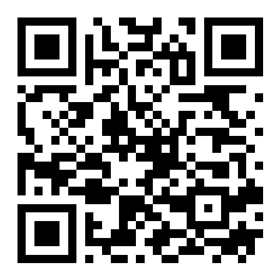

# Laufband

Web-App (PWA) für Android, die Pace, Distanz, Puls und Steigung von einem Bluetooth-Laufband anzeigt,
jeden Lauf speichert und als **FIT-Datei** für Garmin Connect exportiert.

Entwickelt für das **Kettler Track S10** (Bluetooth, Kinomap-kompatibel). Unterstützt zwei Bluetooth-Standards:
**FTMS** (Fitness Machine Service, mit Steigung) und **RSC** (Running Speed and Cadence, wie ein Laufsensor).
Das Track S10 meldet sich als „S10“ mit RSC (0x1814), Herzfrequenz (0x180D) und Geräteinfo (0x180A) – ohne FTMS.
Die Steigung wird über RSC nicht übertragen, der Handpuls des Laufbands wird mitgelesen.

## Funktionen

- Große Anzeige: **Pace** (min/km), **Distanz**, **Puls**, **Zeit**, Ø Pace, Tempo, Steigung
- **Zwischenzeiten pro km**, mit Vibration bei jedem Kilometer
- **Auto-Pause**: Die Zeit läuft nur, solange sich das Band bewegt
- **Pulsgurt** über Bluetooth (Heart Rate Service, z. B. Polar H10 oder Garmin HRM-Dual). Ohne Gurt wird der
  Handpuls des Laufbands genutzt, falls es ihn sendet
- **Lauf-Liste** mit Zusammenfassung und km-Tabelle
- **FIT-Export** (Sport „Laufen“, Untersport „Laufband“) für den Import in Garmin Connect
- Bildschirm bleibt während des Laufs an; Läufe werden alle 15 s zwischengespeichert
- Offline nutzbar, installierbar auf dem Startbildschirm
- Diagnose-Ansicht mit Bluetooth-Rohdaten und Demo-Modus zum Ausprobieren ohne Laufband

## Benutzung

1. Die App in **Chrome auf Android** öffnen: **https://limaged1911.github.io/laufband/** (oder QR-Code scannen).
   Über das Chrome-Menü → **„Zum Startbildschirm hinzufügen“** wird sie wie eine App installiert.
2. Laufband einschalten. Kinomap oder andere Apps dürfen **nicht** gleichzeitig verbunden sein.
3. **„Laufband verbinden“** tippen und das Gerät wählen, ggf. **„Pulsgurt verbinden“** (oder oben „+ Laufband“ / „+ Puls“).
4. **Start** drücken und loslaufen. **Beenden** speichert den Lauf.
5. Unter **Läufe** → **FIT-Datei**. Die Datei landet in „Downloads“.
6. Auf [connect.garmin.com/modern/import-data](https://connect.garmin.com/modern/import-data) hochladen
   (am Handy ggf. „Desktopwebsite“ in Chrome aktivieren, oder am PC).

## Wenn das Laufband keine Werte liefert

Unter **Einstellungen → Diagnose → Gerät untersuchen** das Laufband wählen. Die App listet alle Dienste und
zeigt die Rohdaten. Taucht der Dienst `00001826-…` (FTMS) nicht auf, nutzt das Laufband ein eigenes Protokoll –
dann bitte das Log kopieren und weitergeben, damit die Anbindung ergänzt werden kann.

## Technik

- Reines HTML/CSS/JavaScript ohne Build-Schritt und ohne Abhängigkeiten
- `ble.js` – Web Bluetooth: FTMS Treadmill Data (0x2ACD), sonst RSC Measurement (0x2A53),
  Heart Rate Measurement (0x2A37, Pulsgurt oder Handpuls des Laufbands), Auto-Reconnect
- `fit.js` – FIT-Encoder (file_id, event, record, lap, session, activity) mit CRC; geprüft mit dem
  offiziellen Garmin FIT SDK
- `store.js` – Speicherung in IndexedDB (nur lokal auf dem Gerät)
- `sw.js` – Service Worker für Offline-Betrieb
- `fonts/` – Roboto Black Italic (Google Fonts, Apache-2.0) für Pace, Distanz, Zeit und Puls, lokal eingebunden
- Web Bluetooth braucht HTTPS, daher Auslieferung über GitHub Pages

Lokal testen: einen beliebigen statischen Webserver im Ordner starten und `http://localhost:<port>` öffnen
(z. B. `python -m http.server 8000`). Web Bluetooth funktioniert auf `localhost` auch ohne HTTPS.

## Hinweise

- iPhone/iPad: Safari unterstützt kein Web Bluetooth (Alternative: Browser „Bluefy“).
- Ein automatischer Upload zu Garmin Connect ist nicht möglich: Garmin bietet Privatpersonen keine
  offene Upload-Schnittstelle. Der manuelle Import dauert wenige Sekunden.
- Die Daten bleiben auf dem Handy. Wer die Browserdaten von Chrome löscht, löscht auch die Läufe –
  wichtige Läufe vorher als FIT-Datei sichern.
